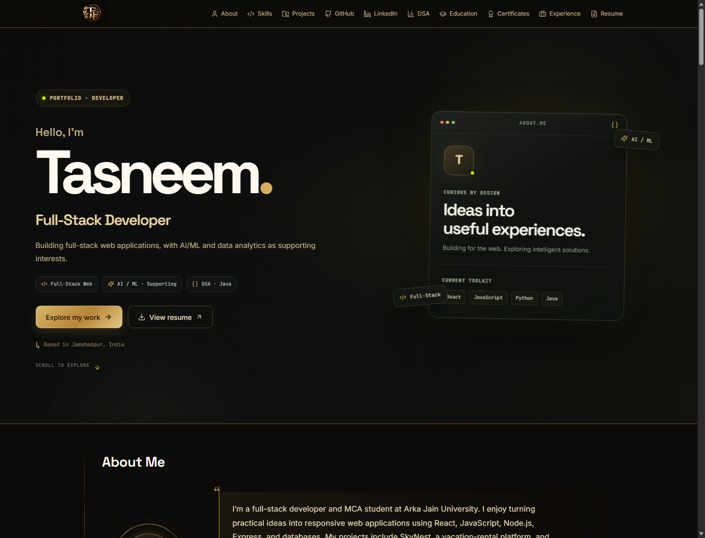

# Tasneem Fatma — Portfolio

A responsive, static portfolio showcasing my full-stack web development work, technical skills, education, and experience. AI/ML and data analytics are included as supporting interests.

<p align="center">
  
</p>

## About the portfolio

The portfolio is built with React and Vite and does not need a custom backend or database. Its content is maintained in the frontend source, and it can be deployed to any static hosting provider.

### Highlights

- Responsive introduction with links to selected work and the resume.
- Skills grouped by category, without subjective percentage ratings.
- Five major projects highlighted, with additional mini projects in an expandable archive.
- GitHub profile and repository information loaded from GitHub's public API.
- LinkedIn and LeetCode profile links. Unverified DSA performance numbers are intentionally not displayed.
- Contact form that opens a prefilled email in the visitor's email application.
- Reduced-motion support for visitors who prefer less animation.

## Tech stack

- **Frontend:** React 18, JavaScript, Vite 5
- **Styling:** CSS, Tailwind CSS
- **Icons:** Lucide React, React Icons, Simple Icons
- **Data:** Portfolio content in JavaScript; public repository information fetched from GitHub

## Run locally

**Requirements:** Node.js and npm.

```bash
cd frontend
npm install
npm run dev
```

Open the local URL printed by Vite, usually `http://localhost:5173`.

## Build and deploy

Create and preview a production build:

```bash
cd frontend
npm run build
npm run preview
```

The production site is generated in `frontend/dist/`. Deploy that folder using a static hosting provider such as Vercel, Netlify, or GitHub Pages. No server-side environment variables are required.

## Updating portfolio content

Edit the `DEFAULTS` object in [`frontend/src/utils/constants.js`](frontend/src/utils/constants.js) to update profile details, skills, projects, education, certificates, and experience.

When updating projects, keep each technology list aligned with its repository, and only include live demo URLs that are still available. Project screenshots and artwork are stored in `frontend/public/project-images/`.

## Project structure

```text
.
├── docs/
│   └── images/
│       └── portfolio-hero.png
└── frontend/
    ├── public/
    │   └── project-images/
    └── src/
        ├── components/public/
        ├── pages/
        └── utils/
```

## Profiles

- [GitHub](https://github.com/TasneemFatma012)
- [LinkedIn](https://www.linkedin.com/in/tasneem-fatma-7933ba344)
- [LeetCode](https://leetcode.com/u/TasneemFatma012/)
